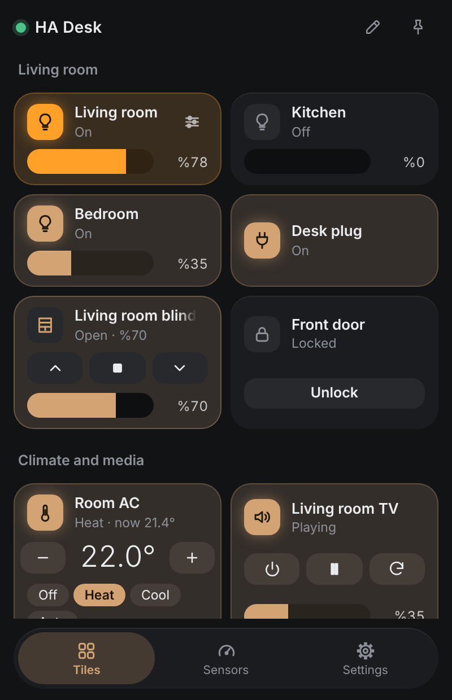
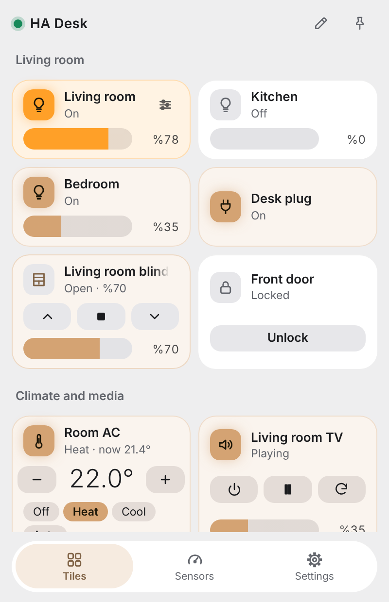
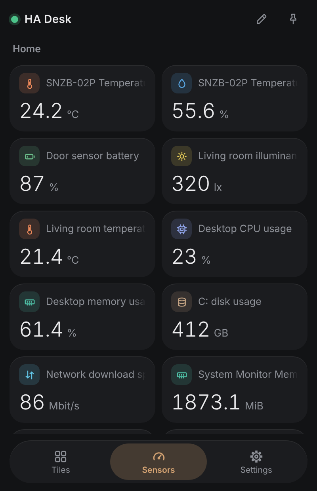
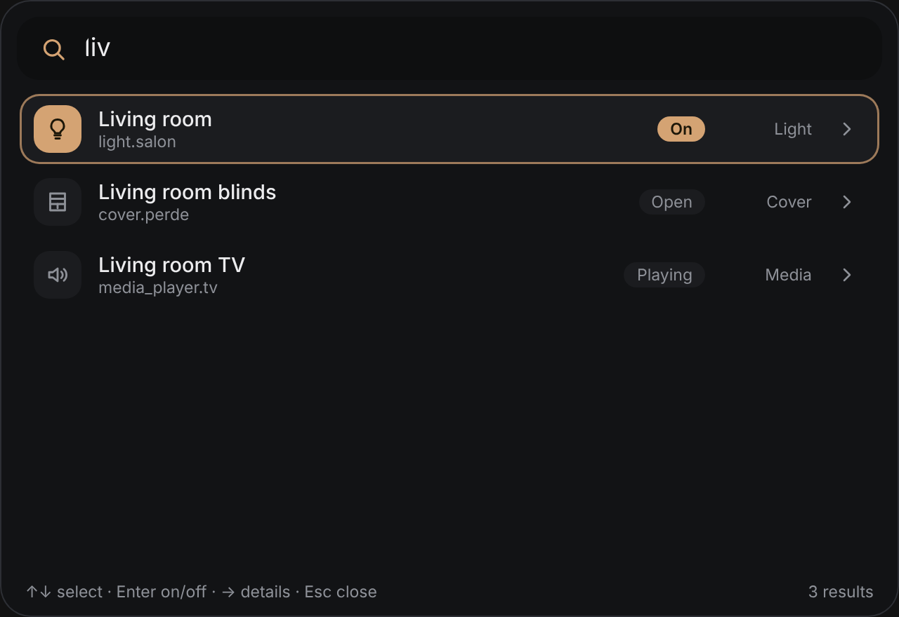
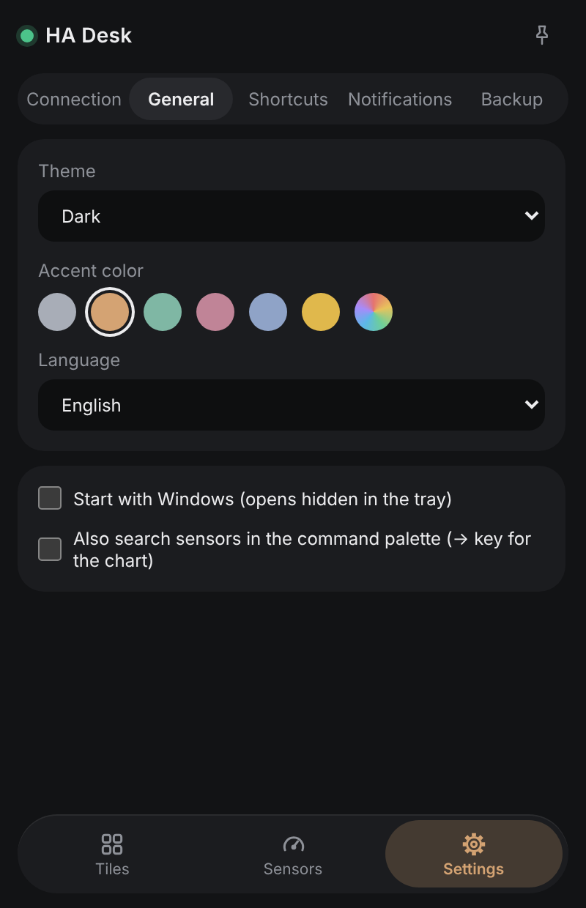

<p align="center"></p>

<h1 align="center">HA Desk</h1>

<p align="center">A small Windows tray app that controls <a href="https://www.home-assistant.io/">Home Assistant</a> directly from your desktop.<br>English | <a href="README.tr.md">Turkce</a></p>

<p align="center">
  
  
</p>

## Features

- **Tray popup** with tiles for lights, switches, covers, locks, climate and media players. Group tiles into sections and drag to reorder.
- **Light panel**: brightness, colour temperature and colour. The tile shows the light's real colour.
- **Sensors page** with per-type icons and colours, plus history charts. PC sensors (CPU, RAM, disk, network) are recognised by name.
- **Command palette** (global shortcut, Wox style): search entities, toggle them, or type a sentence and send it to Home Assistant **Assist**.
- **Notification rules**: raise a Windows notification when a state changes or crosses a threshold. Notifications sent from HA to the app's mobile_app device show up as Windows notifications too.
- **Rooms**: tiles can follow Home Assistant areas.
- Dark, light and system theme with accent colours, Turkish and English UI, autostart, pin on top.
- Your token is stored in **Windows Credential Manager**, not in a file.

<p align="center">
  
  
  
</p>

<sub>Screenshots use demo data.</sub>

## Install

1. Download the latest installer (`ha-desk_x.y.z_x64-setup.exe`) from [Releases](../../releases).
2. Run it. The installer is **not code-signed yet**, so Windows SmartScreen may warn you: choose *More info*, then *Run anyway*. You can compare the file with `SHA256SUMS.txt` from the release page.

## First-time setup

1. In Home Assistant open your profile (bottom-left), go to **Security**, scroll to **Long-lived access tokens** and click *Create token*.
2. Start HA Desk, open **Settings > Connection**, enter your Home Assistant URL (for example `http://homeassistant.local:8123`) and paste the token.
3. Add tiles with the pencil button in the header. Pick entities, name your groups, done.

Optional: in the Notifications settings you can register the app as a mobile_app device so Home Assistant can push notifications to your PC. The device then appears in HA's automation actions as `notify.mobile_app_...`.

## Build from source

Requirements: Node 20+, Rust (stable) and the [Tauri 2 prerequisites](https://tauri.app/start/prerequisites/) for Windows.

```bash
npm install
npm run tauri dev      # run in development
npm run tauri build    # build the installer into src-tauri/target/release/bundle
```

Stack: Tauri 2, Svelte 5, TypeScript. The app talks to Home Assistant over its WebSocket API.

## Releases

Pushing a tag such as `v0.1.0` runs `.github/workflows/release.yml`. It builds the Windows installer and attaches it, together with `SHA256SUMS.txt`, to a draft release.

## License

[MIT](LICENSE) (c) YasoDigo
