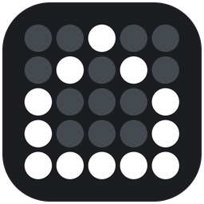
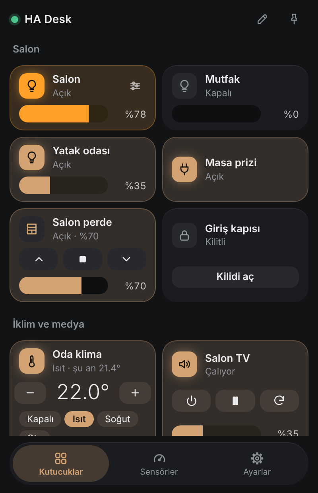
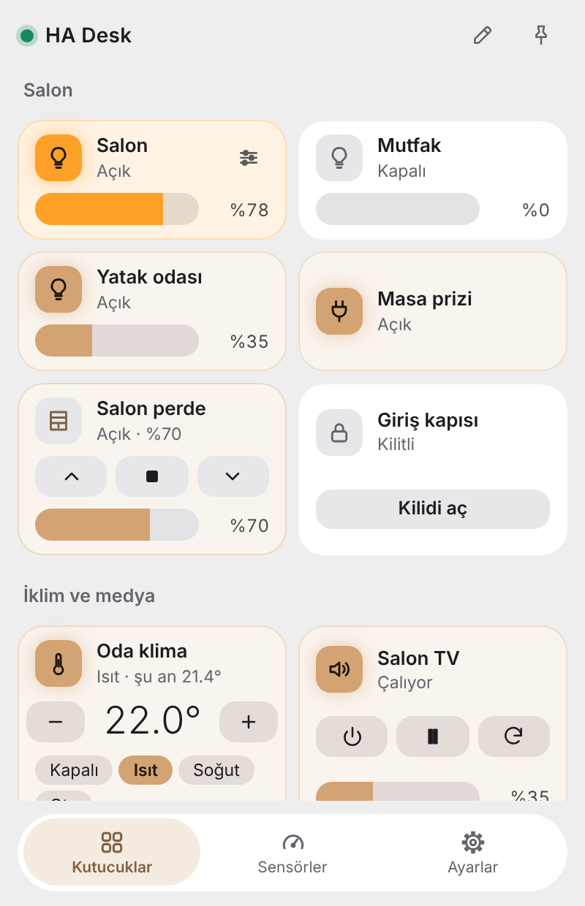
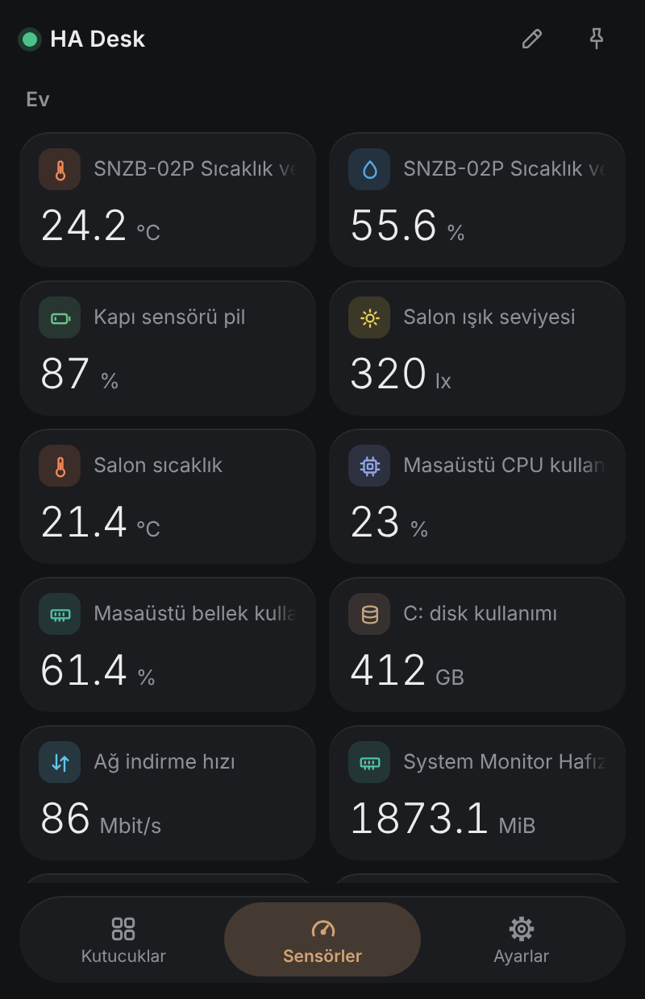
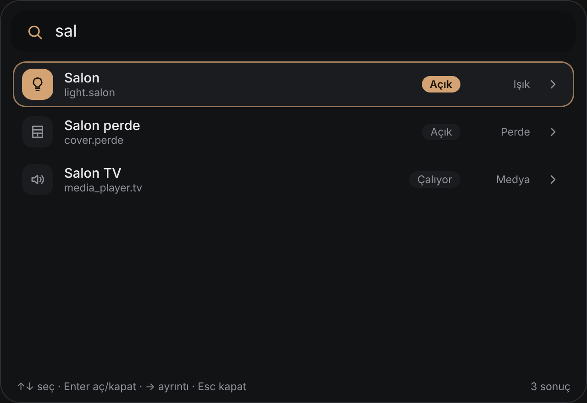
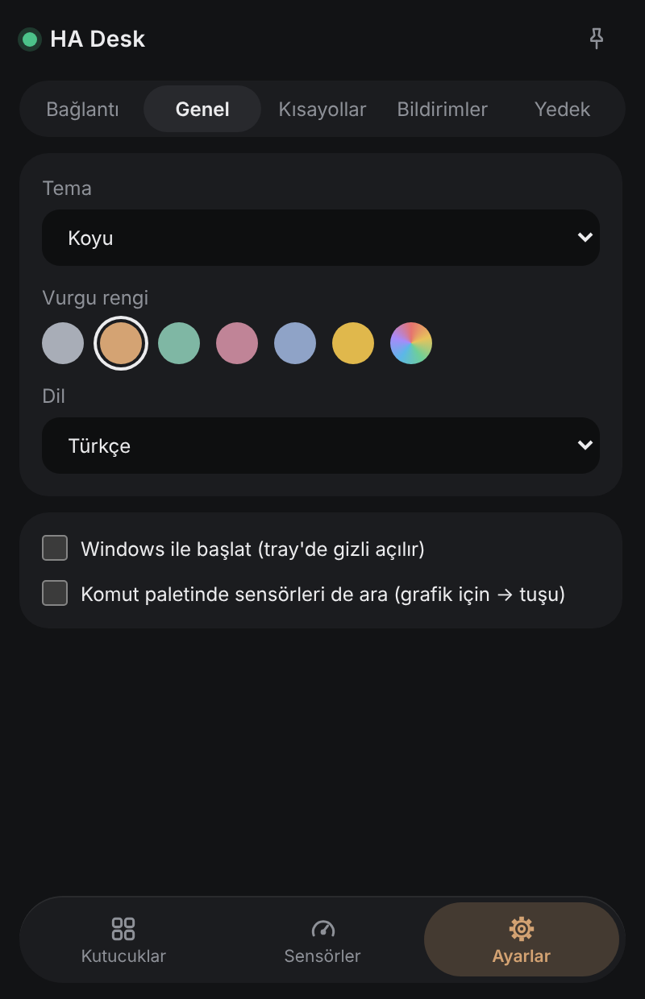

<p align="center"></p>

<h1 align="center">HA Desk</h1>

<p align="center">Windows tepsisinde çalışan, <a href="https://www.home-assistant.io/">Home Assistant</a>'ı doğrudan masaüstünden kontrol eden küçük bir uygulama.<br><a href="README.md">English</a> · Türkçe</p>

<p align="center">
  
  
</p>

## Özellikler

- Işık, anahtar, perde, kilit, klima ve medya oynatıcılar için **tepsi penceresi**; kutucukları gruplara ayır, sürükleyerek sırala.
- **Işık paneli**: parlaklık, renk sıcaklığı ve renk; kutucuk ışığın gerçek rengini gösterir.
- Türe göre ikon ve renkli **sensör sayfası**, geçmiş grafikleri. Bilgisayar sensörleri (işlemci, RAM, disk, ağ) adından tanınır.
- **Komut paleti** (global kısayol, Wox tarzı): cihaz ara, aç/kapat ya da bir cümle yazıp Home Assistant **Assist**'e gönder.
- **Bildirim kuralları**: durum değişince veya eşik aşılınca Windows bildirimi. HA'dan uygulamanın mobile_app cihazına giden bildirimler de Windows bildirimi olarak görünür.
- **Odalar**: kutucuklar Home Assistant alanlarını (area) izleyebilir.
- Koyu / açık / sistem teması ve vurgu renkleri, Türkçe ve İngilizce arayüz, otomatik başlatma, üstte sabitleme.
- Token dosyada değil, **Windows Kimlik Bilgisi Yöneticisi**'nde saklanır.

<p align="center">
  
  
  
</p>

<sub>Ekran görüntülerinde örnek veri kullanıldı.</sub>

## Kurulum

1. [Releases](../../releases) sayfasından son kurulum dosyasını (`ha-desk_0.1.0_x64-setup.exe`) indir.
2. Çalıştır. Kurulum dosyası **henüz imzalı değil**, bu yüzden SmartScreen uyarabilir: *Daha fazla bilgi → Yine de çalıştır*. Dosyayı sürüm sayfasındaki `SHA256SUMS.txt` ile karşılaştırabilirsin.

## İlk kurulum

1. Home Assistant'ta profilini aç (sol altta) → **Güvenlik** → **Uzun ömürlü erişim belirteçleri** → *Belirteç oluştur*.
2. HA Desk'i aç, **Ayarlar → Bağlantı** bölümüne Home Assistant adresini (örneğin `http://homeassistant.local:8123`) yaz ve token'ı yapıştır.
3. Başlıktaki kalem düğmesiyle kutucuk ekle: cihazları seç, gruplara isim ver, bitti.

İsteğe bağlı: Ayarlar → Bildirimler'den uygulamayı mobile_app cihazı olarak kaydedersen HA bilgisayarına bildirim gönderebilir (cihaz HA otomasyonlarında `notify.mobile_app_…` olarak görünür).

## Kaynaktan derleme

Gereksinimler: Node 20+, Rust (stable) ve Windows için [Tauri 2 ön koşulları](https://tauri.app/start/prerequisites/).

```bash
npm install
npm run tauri dev      # geliştirme modunda çalıştır
npm run tauri build    # kurulum dosyası src-tauri/target/release/bundle altında
```

Teknoloji: Tauri 2, Svelte 5, TypeScript. Uygulama Home Assistant ile WebSocket API üzerinden konuşur.

## Sürüm yayınlama

`v0.1.0` gibi bir etiket gönder; `.github/workflows/release.yml` Windows kurulum dosyasını derler ve `SHA256SUMS.txt` ile birlikte taslak sürüme ekler.

## Lisans

[MIT](LICENSE) © YasoDigo
